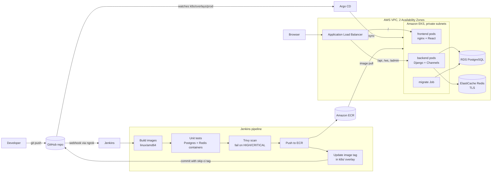

# Cloud-Native CI/CD Platform on Amazon EKS with Self-Healing Deployments

An end-to-end platform that takes a real-time collaboration app (**CollabSup**: Django + React) from a `git push` to a self-healing deployment on Kubernetes, with infrastructure built entirely in Terraform.

**Stack:** Terraform · HCP Terraform · AWS (VPC, EKS, ECR, RDS, ElastiCache, IAM, KMS, ALB) · Docker · Jenkins · Trivy · Kustomize · Argo CD · Kubernetes

---

## What this project demonstrates

- **Infrastructure as Code.** A VPC, EKS cluster, PostgreSQL, Redis and container registries are provisioned from three reusable Terraform modules, plus an add-ons module that installs the AWS Load Balancer Controller with Helm.
- **Continuous Integration with Jenkins.** Every push builds both images, runs the Django test suite against throwaway Postgres and Redis containers, scans the images with Trivy, and pushes them to Amazon ECR.
- **Continuous Delivery with GitOps.** Jenkins never touches the cluster. It commits the new image tag to Git, and Argo CD rolls it out to EKS.
- **Self-healing and zero-downtime deployments.** Health probes, rolling updates, replica management, PodDisruptionBudgets, spreading pods across nodes and Availability Zones, and Argo CD's drift correction.
- **Security built in.** Image vulnerability gating, non-root read-only containers, least-privilege IAM, IRSA (no AWS keys in pods), KMS-encrypted Kubernetes Secrets, private subnets, and TLS to Redis.

---

## Architecture



### Network layout

| Tier | Subnets (one per AZ) | Internet access | Contents |
|---|---|---|---|
| Public | `10.0.1.0/24`, `10.0.2.0/24` | In and out (Internet Gateway) | ALB, NAT Gateway |
| Private | `10.0.16.0/20`, `10.0.32.0/20` | Outbound only (NAT) | EKS nodes and pods |
| Database | `10.0.101.0/24`, `10.0.102.0/24` | None | RDS, ElastiCache |

The private subnets are `/20` because the Amazon VPC CNI gives every pod its own VPC IP address. The database security groups accept traffic only from the private (EKS) subnets.

---

## Repository structure

```
.
├── app/                        # CollabSup application
│   ├── backend/                # Django REST + Channels (WebSockets), Dockerfile
│   └── frontend/               # React + Vite, served by unprivileged nginx, Dockerfile
├── modules/
│   ├── networking/             # VPC, subnets, IGW, NAT, route tables, security groups
│   ├── eks/                    # Cluster, managed node group, IRSA OIDC, KMS, add-ons
│   ├── data/                   # RDS PostgreSQL + ElastiCache Redis
│   └── addons/                 # AWS Load Balancer Controller (IRSA role + Helm release)
├── k8s/
│   ├── base/                   # Deployments, Services, PDBs, Ingress, migration Job
│   └── overlays/prod/          # Namespace, ConfigMap, image tags (updated by Jenkins)
├── argocd/application.yaml     # Argo CD Application (auto-sync + self-heal)
├── Jenkinsfile                 # CI pipeline + GitOps hand-off
├── main.tf  provider.tf  variables.tf  outputs.tf
└── terraform-provisioner-policy.json   # Least-privilege IAM policy for the Terraform user
```

---

## Infrastructure (Terraform)

State is stored and locked in **HCP Terraform**. Every resource name starts with the `cloudnative-` prefix, and the Terraform IAM user's policy only allows creating IAM roles and policies with that prefix.

| Module | Creates | Notes |
|---|---|---|
| `networking` | VPC, 6 subnets, IGW, NAT Gateway, route tables, DB and Redis security groups | Uses `for_each` keyed by AZ, so adding or removing a zone never reshuffles resources |
| `eks` | EKS 1.35 cluster, managed node group (AL2023), OIDC provider, KMS key, CloudWatch logs, VPC CNI, CoreDNS, kube-proxy, Pod Identity agent | `upgrade_policy = STANDARD` avoids extended-support pricing; node groups use `create_before_destroy` |
| `data` | RDS PostgreSQL 16 (`db.t4g.micro`), ElastiCache Redis 7.1 (`cache.t3.micro`) | RDS generates and stores the master password in Secrets Manager; Redis has at-rest and in-transit encryption |
| `addons` | AWS Load Balancer Controller (Helm) with its own IRSA role | Turns the Kubernetes Ingress into an internet-facing ALB |
| root | ECR repositories `cloudnative-backend` and `cloudnative-frontend` | Immutable tags, scan on push, lifecycle policy that keeps the last 30 images |

---

## CI pipeline (Jenkins)

| Stage | What it does |
|---|---|
| **Check Trigger** | Skips the build if the latest commit contains `[skip ci]` (Jenkins' own deploy commits), which prevents a build loop |
| **Build** | Builds the backend and frontend images for `linux/amd64`, tagged `<build number>-<git sha>`. A date-based cache-bust argument re-runs the OS package upgrade layer daily, so new security fixes are always included |
| **Unit Tests** | Runs 37 Django tests against temporary Postgres 16 and Redis 7 containers on an isolated Docker network |
| **Trivy Scan** | Fails the build on any fixable HIGH or CRITICAL vulnerability |
| **ECR Login / Push** | Pushes both images to ECR |
| **Update GitOps Manifests** | Runs `kustomize edit set image` in `k8s/overlays/prod` and commits `ci: deploy <tag> [skip ci]` back to GitHub |

The pipeline is triggered by a GitHub webhook (through ngrok, because Jenkins runs locally) and declared in code with `triggers { githubPush() }`.

---

## Continuous delivery (Argo CD)

Argo CD watches `k8s/overlays/prod` on `main` with **automated sync**, **prune**, and **self-heal** enabled. Deploying means changing Git, so every release is a commit and every rollback is a `git revert`.

Sync waves enforce a safe order on each release:

| Wave | Resource | Why |
|---|---|---|
| -2 | `backend-config` ConfigMap | The migration Job needs it |
| -1 | `migrate` Job (`manage.py migrate`) | New code never runs against an old database schema; a failed migration stops the rollout |
| 0 | Deployments, Services, PDBs, Ingress | Rolled out only after migrations succeed |

---

## Self-healing and reliability

| Mechanism | Behaviour |
|---|---|
| **Readiness probes** | A pod receives traffic only once it's ready; failing pods are removed from the Service |
| **Liveness probes** | A hung container is restarted automatically by the kubelet |
| **Startup probe** (backend) | Gives Django time to boot before liveness checks begin |
| **ReplicaSets** (2 replicas each) | Deleted or crashed pods are recreated immediately |
| **Rolling updates** (`maxSurge: 1`, `maxUnavailable: 0`) | A new pod must be ready before an old one stops, so deploys cause no downtime |
| **PodDisruptionBudgets** (`minAvailable: 1`) | Node drains and upgrades can never take a service to zero pods |
| **Topology spread** | Replicas are spread across nodes and Availability Zones |
| **Managed node group** (`max_unavailable = 1`) | Failed nodes are replaced by the Auto Scaling group; node upgrades roll one at a time |
| **Argo CD self-heal** | Manual changes (for example `kubectl scale`) are reverted to what Git declares |

**Try it:**

```bash
# Kubernetes replaces deleted pods
kubectl delete pod -n collabsup -l app=backend --wait=false
kubectl get pods -n collabsup -w

# Argo CD reverts drift back to Git (2 replicas)
kubectl scale deployment backend -n collabsup --replicas=1
kubectl get deployment backend -n collabsup -w
```

---

## Security

- **Image scanning:** Trivy blocks fixable HIGH and CRITICAL CVEs before an image reaches ECR. ECR also scans on push.
- **Hardened containers:** run as non-root, read-only root filesystem, all Linux capabilities dropped, `RuntimeDefault` seccomp profile, no privilege escalation, no service-account token mounted.
- **Least-privilege IAM:** the Terraform user can only create IAM roles and policies prefixed `cloudnative-`. The Load Balancer Controller uses **IRSA**, a role that only its own service account can assume, so no AWS keys are stored in the cluster.
- **Encryption:** Kubernetes Secrets are encrypted with a customer-managed KMS key, RDS storage is encrypted, and Redis uses TLS (`rediss://`) and encryption at rest.
- **Network isolation:** nodes run in private subnets, and the databases sit in subnets with no internet route.
- **Secrets stay out of Git:** application secrets live in a Kubernetes Secret, and the database password is generated by RDS and stored in Secrets Manager.

---

## Setup

### Prerequisites

- An AWS account and an IAM user with `terraform-provisioner-policy.json` attached
- An HCP Terraform workspace, with `AWS_ACCESS_KEY_ID` and `AWS_SECRET_ACCESS_KEY` set as sensitive environment variables
- `terraform` 1.12.2, `aws` CLI, `kubectl`, Docker
- Jenkins with Docker access and these credentials: `my_aws`, `aws-account-id`, `brevo-api-key`, `github-token`

### 1. Provision the infrastructure

```bash
terraform init
terraform apply          # ~20 minutes: VPC, EKS, RDS, Redis, ECR, Load Balancer Controller
aws eks update-kubeconfig --region us-east-1 --name cloudnative-eks
kubectl get nodes
```

### 2. Build and push the images

Push a commit (or click **Build Now** in Jenkins). The pipeline pushes images to ECR and updates the image tags in `k8s/overlays/prod/kustomization.yaml`.

### 3. Create the application Secret

Get the database password from Secrets Manager: run `terraform output db_master_secret_arn`, open that secret in the console, choose **Retrieve secret value**, and copy the `password` value.

```bash
kubectl create namespace collabsup
kubectl create secret generic backend-secrets -n collabsup \
  --from-literal=DB_PASSWORD='<password>' \
  --from-literal=SECRET_KEY="$(python3 -c 'import secrets; print(secrets.token_urlsafe(50))')" \
  --from-literal=BREVO_API_KEY='<brevo key>'
```

### 4. Install Argo CD and deploy

```bash
kubectl create namespace argocd
kubectl apply -n argocd --server-side --force-conflicts \
  -f https://raw.githubusercontent.com/argoproj/argo-cd/stable/manifests/install.yaml
kubectl wait -n argocd --for=condition=available deployment --all --timeout=300s

kubectl apply -f argocd/application.yaml
kubectl get pods -n collabsup -w
```

### 5. Open the app

```bash
kubectl get ingress -n collabsup     # the ADDRESS column is the ALB URL
```

Set `FRONTEND_URL` in `k8s/overlays/prod/backend-config.yaml` and `VITE_WS_URL` in the `Jenkinsfile` to that address, push, then run `kubectl rollout restart deployment backend -n collabsup`.

**Argo CD dashboard:**

```bash
kubectl -n argocd get secret argocd-initial-admin-secret -o jsonpath='{.data.password}' | base64 -d; echo
kubectl port-forward svc/argocd-server -n argocd 8443:443   # then open https://localhost:8443 (user: admin)
```

---

## Teardown

The ALB is created by the Load Balancer Controller rather than by Terraform, so remove the app first, or the VPC can't be deleted.

```bash
kubectl delete -f argocd/application.yaml
kubectl get ingress -n collabsup -w          # wait until the Ingress (and its ALB) is gone
terraform destroy
```

---

## Cost notes

Approximate monthly cost if left running: EKS control plane about $73, 2 × `m7i-flex.large` nodes about $140, NAT Gateway about $32, RDS and Redis micro instances about $25. The platform is designed to be destroyed after each working session and rebuilt with `terraform apply`. ECR repositories use `force_delete`, and RDS skips its final snapshot, so teardown is clean.

---

## Challenges and lessons learned

| Problem | Cause | Fix |
|---|---|---|
| Node group stuck in `CREATING` | The AWS Free plan blocks `t3.medium` (Auto Scaling activity: *instance type not eligible*) | Switched to the plan-eligible `m7i-flex.large` (2 vCPU, 8 GiB) |
| Node group replacement blocked | The new node group reused the name of one still deleting | `node_group_name_prefix` + `create_before_destroy` |
| `CreateNodegroup` denied | EKS checks for its service-linked role with `iam:GetRole` | Added read-only `iam:GetRole` on `role/aws-service-role/*` |
| Images would not run on EKS | Jenkins runs on Apple Silicon (ARM); the nodes are x86 | `docker build --platform linux/amd64` |
| Migration Job failed: ConfigMap not found | An Argo CD `PreSync` hook runs before normal resources exist | Sync waves: ConfigMap (-2), then migration (-1), then workloads (0) |
| Trivy flagged a fixed `libexpat` CVE | Docker reused a cached `apk upgrade` layer from before the fix | A daily cache-bust build argument re-runs OS upgrades |
| Jenkins tag commits re-triggered builds | Its own pushes fire the webhook | `[skip ci]` in deploy commits plus a Check Trigger stage |

---

## Future improvements

- **External Secrets Operator:** sync the RDS password from Secrets Manager automatically, including after rotation
- **Terraform-managed Argo CD:** install Argo CD with `helm_release`, so one `terraform apply` rebuilds the whole platform
- **Custom domain + HTTPS:** a Route 53 record and an ACM certificate on the ALB (`https://` and `wss://`)
- **Horizontal Pod Autoscaler and Cluster Autoscaler (or Karpenter):** scale pods and nodes with load
- **Observability:** Prometheus and Grafana for metrics, with alerts on probe failures and restarts
- **Dedicated Jenkins IAM user:** limited to pushing to the `cloudnative-*` ECR repositories
